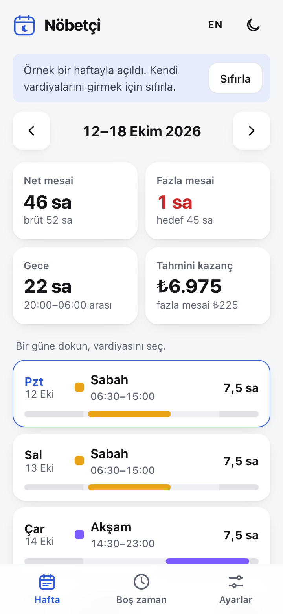
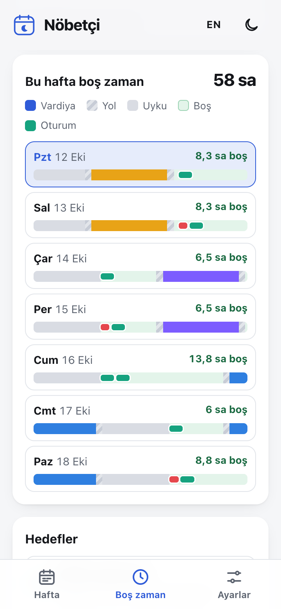
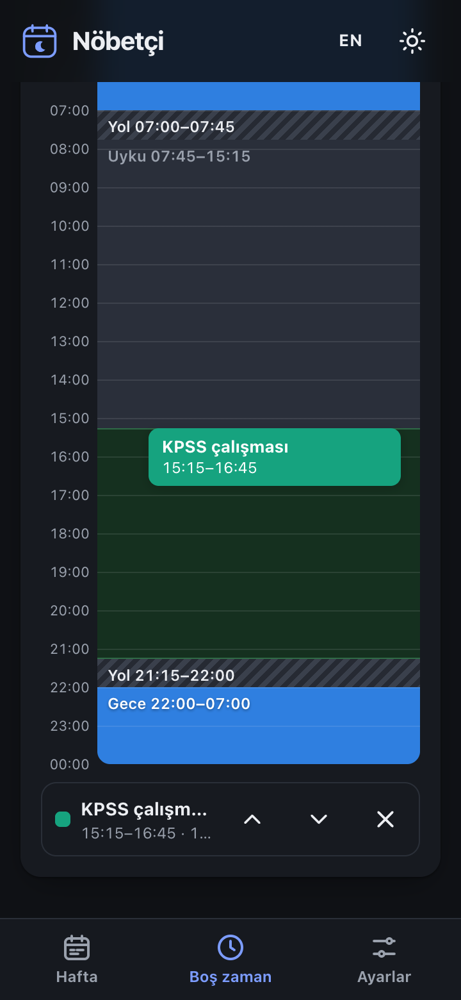
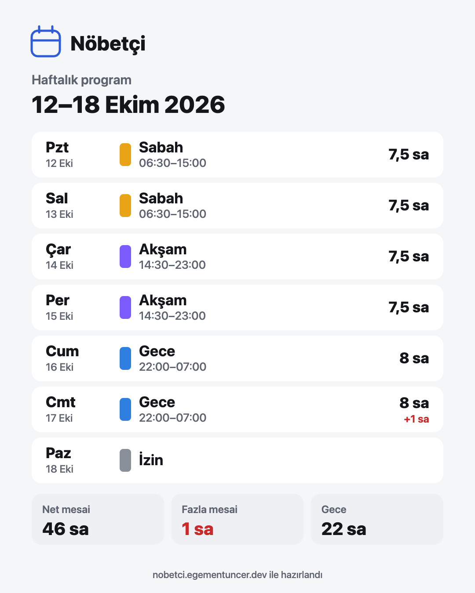

# Nöbetçi — Vardiya & Mesai Planlayıcı

Vardiyalı çalışanlar için mobil öncelikli bir web uygulaması: haftalık vardiyanı gir; net mesaini, fazla mesaini, gece saatlerini ve tahmini kazancını gör. Uyku ve yol süreni hesaba katarak **gerçekten kullanabileceğin boş zamanı** bul ve kişisel hedeflerini (sınav çalışması, spor…) bu zamana otomatik yerleştir.

**Canlı demo:** https://nobetci.egementuncer.dev · **Testler:** https://nobetci.egementuncer.dev/tests/

> İlk açılışta örnek bir haftayla dolu gelir; “Sıfırla” ile kendi verilerine başlarsın.

| Hafta | Boş zaman | Gün çizelgesi (koyu tema) | Paylaşım kartı |
| :---: | :---: | :---: | :---: |
|  |  |  |  |

---

## Problem

Vardiyalı çalışan biri için iki şeyi aynı anda takip etmek zor:

1. **Mesai:** Gece yarısını geçen vardiyalar, molalar, haftalık hedefi aşan fazla mesai ve gece çalışması kâğıt üzerinde ya da kafada hesaplanınca kolayca karışıyor.
2. **Kişisel zaman:** Takvim “boş” görünse de gerçek boş zaman çok daha az. Vardiyadan önce hazırlanmak ve yola çıkmak, sonra eve dönmek, gece vardiyasından sonra gündüz uyumak gerekiyor. Bir sınava çalışmak ya da spor yapmak isteyen biri haftada gerçekten kaç saati olduğunu ve bunu nereye koyacağını bilmiyor.

## Çözüm

Nöbetçi vardiyaları şablonlarla birkaç dokunuşta girdirir, mesaiyi doğru hesaplar ve vardiyaların çevresindeki zamanı uyku ve yol süresiyle birlikte modelleyerek **kullanılabilir boş zamanı** çıkarır. Hedefleri bu zamana adil biçimde dağıtır; sığmayanı açıkça söyler.

---

## Özellikler

### ✦ Boş zaman bulucu (öne çıkan özellik)

- **Uyku penceresi** (ör. 00:00–07:30) ve vardiyadan önceki/sonraki **hazırlık + yol** süresi (ör. 45 dk) girilir.
- Her gün için zaman çizelgesi çıkarılır: **vardiya / yol / uyku / boş** renk kodlu.
- Uyku vardiyaya göre akıllıca ayarlanır:
  - Sabah vardiyasında erken kalkılır (00:00–07:30 → 00:00–05:45).
  - Gece vardiyasında aynı uzunlukta uyku vardiya + yol bittikten sonraya kayar (gündüz uykusu).
- **Hedefler:** “KPSS çalışması — haftada 12 saat, oturum 45–90 dk” gibi bir ya da birden fazla hedef.
- **Planla** butonu hedefleri boş dilimlere yerleştirir:
  - oturumlar mümkün olduğunca **farklı günlere yayılır**,
  - vardiya (+ yol) bitiminden hemen sonraki **30 dakikaya** ve uyku öncesi son **30 dakikaya** oturum konmaz,
  - aynı gündeki oturumlar arasında 15 dk boşluk kalır,
  - sığmayan süre için net uyarı: *“Bu hafta 7 sa 45 dk sığmadı: Yan proje”*.
- Planlanan oturumlar **sürüklenerek** taşınabilir (15 dk adım), dolu saate bırakılırsa eski yerine döner. Klavyeyle **↑ ↓** taşır, **Delete** siler; dokunmatik için ayrıca ±15 dk ve sil butonları vardır.
- Algoritma `js/planner.js` içinde, yorumlu ve DOM'dan bağımsız saf fonksiyonlardan oluşur.

### Mesai hesapları

- **Vardiya şablonları:** ad, başlangıç, bitiş, mola, renk. Varsayılanlar: Sabah 06:30–15:00 (60 dk mola), Akşam 14:30–23:00 (60 dk), Gece 22:00–07:00 (60 dk), İzin.
- **Haftalık görünüm:** 7 günlük şerit; güne dokununca şablon seçilir. Önceki/sonraki hafta, “Bugün”, “Geçen haftayı kopyala”.
- Hafta ve ay için: **brüt saat**, **mola düşülmüş net saat**, **fazla mesai** (haftalık hedef ayarlanabilir, varsayılan 45 sa), **gece saatleri** (varsayılan 20:00–06:00, ayarlanabilir), saatlik ücret girilirse **tahmini kazanç** (fazla mesai çarpanı varsayılan 1,5).
- Gece yarısını geçen vardiyalar (22:00–06:00) doğru hesaplanır.
- Fazla mesai kronolojik dağıtılır: haftalık toplam hedefi hangi gün aşıyorsa aşan kısım o güne yazılır. Böylece ay sınırını geçen haftalarda **aylık** fazla mesai de doğru çıkar.

### Diğer

- **Takvime aktar:** haftanın vardiyaları ve oturumları `.ics` dosyası olarak (Google Takvim, iOS/macOS Takvim, Outlook). Saat dilimi Europe/Istanbul.
- **Paylaşılabilir görsel:** haftalık programı 1080×1350 PNG kart olarak indir (canvas, harici servis yok). Kişisel hedef oturumları karta girmez; yalnızca vardiyalar paylaşılır.
- **Veri yedeği:** JSON dışa/içe aktarma (içe aktarılan veri doğrulanır).
- **TR / EN** dil, **açık / koyu** tema (sistem tercihini izler, elle değiştirilebilir).
- **PWA:** telefona eklenebilir, çevrimdışı açılır (service worker).
- **Demo modu:** ilk açılışta örnek hafta ve planlanmış hedeflerle gelir; “Sıfırla” ile temizlenir.
- Veriler yalnızca cihazda (`localStorage`) tutulur. Depolama kapalıysa (gizli mod vb.) uygulama yine çalışır ve uyarı gösterir.

### Erişilebilirlik ve kalite

- Semantik HTML, “İçeriğe geç” bağlantısı, tek `h1`, mantıklı başlık sırası.
- Görünen metin erişilebilir adın içinde (WCAG 2.5.3); ek talimatlar `aria-describedby` ile.
- Klavyeyle tam kullanım; native `<dialog>` paneller (Esc ile kapanır, odak geri döner).
- 360 px genişlikte yatay kaydırma yok; dokunma alanları ≥ 44 px.
- `prefers-reduced-motion` açıksa GSAP ve CSS animasyonları kapanır.
- axe ile açık/koyu temada bütün görünümler temiz.

**Lighthouse (mobil, yerel ölçüm):** Performance 100 · Accessibility 100 · Best Practices 100 · SEO 100

---

## Teknolojiler

- **HTML, CSS, vanilla JavaScript** (ES modülleri). Framework ve build adımı yok.
- **[GSAP 3](https://gsap.com/)** (cdnjs): hafta geçişleri ve “Planla” sonrası oturum animasyonları. GSAP yüklenmezse uygulama animasyonsuz çalışır.
- **Canvas API:** paylaşım kartı. **Service Worker:** çevrimdışı çalışma.
- **Cloudflare Workers (static assets):** yayın; `_headers` ile güvenlik ve önbellek başlıkları.

## Dosya yapısı

```
.
├── index.html             # Uygulama kabuğu
├── css/style.css          # Stiller (tema token'ları, bileşenler)
├── js/
│   ├── app.js             # Arayüz: durum, görünümler, olaylar
│   ├── calc.js            # Mesai hesapları (saf fonksiyonlar)
│   ├── planner.js         # Boş zaman bulucu ve planlayıcı (saf fonksiyonlar)
│   ├── ics.js             # .ics üretimi (saf fonksiyonlar)
│   ├── share.js           # PNG paylaşım kartı (canvas)
│   ├── storage.js         # Veri modeli, localStorage, doğrulama, demo, JSON yedek
│   └── i18n.js            # TR/EN metinler ve biçimlendirme
├── tests/                 # Tarayıcıda açılan test sayfası + Node çalıştırıcı
├── assets/                # İkonlar, og-image
├── manifest.webmanifest, sw.js
├── _headers, robots.txt, sitemap.xml, wrangler.jsonc, .assetsignore
└── docs/                  # README görselleri (yayına çıkmaz)
```

## Testler

Hesaplama, planlama, `.ics` ve depolama fonksiyonları saf olduğu için doğrudan test edilir (35 test): gece yarısını geçen vardiya, mola düşümü, gece saatleri, fazla mesai (gün ortasında bölünme ve ay sınırı dahil), kazanç, uyku kaydırma, boş dilimler, planlayıcının yayma ve dinlenme kuralları, sığmayan saatlerin raporu, elle taşıma kontrolü, `.ics` biçimi, bozuk veri temizliği.

- Tarayıcıda: `tests/index.html` (yerel sunucuda) ya da canlıda `/tests/`
- Komut satırında: `npm test` (Node 20+)

## Yerelde çalıştırma

ES modülleri ve service worker yüzünden dosyayı doğrudan (`file://`) açmak yerine basit bir sunucu kullanın:

```bash
python3 -m http.server 8800
```

Ardından http://localhost:8800 adresini açın.

## Deploy (Cloudflare)

1. Depoyu GitHub'a gönderin.
2. Cloudflare → **Workers & Pages** → **Create** → depoyu bağlayın.
3. Build command: _(boş)_ · Deploy command: `npx wrangler deploy` · Root directory: _(boş)_
   - `wrangler.jsonc` statik dosya klasörünü ve 404 davranışını tanımlar; `.assetsignore` yayına çıkmayacak dosyaları (README, docs, .git…) dışarıda bırakır.
4. **Settings → Domains & Routes → Add → Custom domain:** `nobetci.egementuncer.dev`

Sonraki her `git push` otomatik yayına alınır.

---

## Not

Kendi vardiyalı iş deneyimimden doğdu; yapay zekâ destekli geliştirildi, ürün kararları bana ait.

Bu proje [egementuncer.dev](https://egementuncer.dev) portföyü için hazırlanmıştır.
